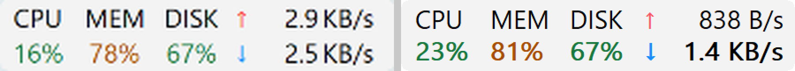

# SysMon Chip · Win11 极轻量资源条

复刻 MangoDisk「任务栏资源条」外观的 Windows 11 小挂件：两行文字实时显示 **CPU / 内存 / 系统盘 / 上下行网速**，单文件、免安装、不要管理员、不写驱动、不联网。

- 发布物（推荐）：`发布/SysMonChipLite.exe`（**56.5 KB**，PE 版本 **2.0.0.0**，no_std 极限轻量版，功能与界面同 std 版逐像素一致）
- 发布物（std 版，保底）：`发布/SysMonChip.exe`（326.5 KB，v0.3.0.0）；两版共用同一份配置与单实例互斥，可随时互换对照
- **v2.0 Lite（2026-11-10）**：抽出 no_std 共享核心 `chip_core`，外壳 `app_ultra` 不链接 Rust std（文件/注册表/命令行走 Win32）→ 体积 **327 KB → 56 KB（−83%）**，启动更快，功能/界面/稳定性与 std 版持平
- **v1.1（2026-11-10）**：字号 +8%（标签 9.75 pt / 数值 10 pt）、面板 194→198 逻辑像素并重排列位、网速宽度自适应、桌面模式贴任务栏上沿+屏幕右缘、新增 `--demo`
- 实测（Lite，10 分钟 300 拍）：工作集 **1.05–2.87 MB（均值 1.52）/ 私有 1.81 MB / CPU 0.154% 单核（整机 0.019%）**；启动 P50 **32.5 ms**；句柄 137 / GDI 13 / USER 5 零增长
- 对照：eframe/egui 最简空窗口 126.9 MB（本机实测）；MangoDisk 是 Tauri + WebView2（47 MB exe + 数百 MB 进程族）
- 独立复核：`验收报告-Lite-20261110.md`（Lite，通过）与 `验收报告-20261110.md`（std 版）


左：参考（MangoDisk 任务栏左端资源条）　右：本工具

## 快速开始

1. 双击 `发布/SysMonChipLite.exe`（或 std 版 `SysMonChip.exe`），任务栏左端出现资源条，同时托盘出现图标。
2. **右键资源条**（或托盘图标）打开菜单。
3. 默认位置：**贴任务栏左端**（与参考图同款，225% 下窗口 446×81、坐标 (9, 2065)–(455, 2146)，与 MangoDisk 日志记录基本一致）。菜单「位置」里还有：桌面右下角（贴任务栏上沿 + 贴屏幕右缘，0 间距）、自由拖动。
4. 左键拖动可移动（未锁定时），松手后自动记入配置。
5. 关闭：菜单「退出」，或命令行 `SysMonChip.exe --quit`。

## 右键菜单

| 菜单项 | 说明 |
|---|---|
| 显示指标 | CPU / 内存 / 磁盘 / 网速 逐项开关 |
| 位置 | 贴任务栏左端（默认，整条覆盖任务栏高度）/ 桌面右下角 |
| 刷新间隔 | 0.5 / 1 / 2 / 5 秒（默认 1 秒） |
| 主题 | 跟随系统（默认）/ 浅色 / 深色 |
| 锁定位置 | 锁定后左键拖动无效 |
| 全屏时隐藏 | 前台是全屏窗口时自动隐藏，退出全屏恢复 |
| 开机自启 | 写 `HKCU\Software\Microsoft\Windows\CurrentVersion\Run\SysMonChip`，默认关闭 |
| 退出 | 结束进程 |

## 命令行

| 参数 | 作用 |
|---|---|
| 无 | 正常启动（单实例，重复启动只唤醒已有实例） |
| `--quit` | 让已运行的实例退出（验收/脚本用） |
| `--dump` | 采样 1 秒后把读数写到 `%TEMP%\sysmonchip-dump.txt` 并退出（验收用） |
| `--trace` | 启动后在 `%TEMP%\sysmonchip-trace.txt` 写启动耗时与 DPI/尺寸 |
| `--demo` | 固定最坏读数（CPU/内存/磁盘 100%、网速最大）用于排版自检 |
| `--autostart` | 由开机自启项传入，无副作用（仅作标记） |

## 配置

位置：`%APPDATA%\SysMonChip\config.ini`（UTF-8，简单 key=value；损坏或缺失自动回退默认值）。

```ini
mode=taskbar        ; taskbar(默认) | desktop | free（taskbar-right 为预留实验值，菜单未提供）
x=300               ; free 模式的物理坐标
y=400
interval=1000       ; 毫秒
cpu=1
mem=1
disk=1
net=1
theme=auto          ; auto | light | dark
locked=0
hide_fs=1
autostart=0
```

## 数据口径（全部 Win32 轻量接口，不碰 WMI / COM / PDH）

| 指标 | 来源 | 公式 |
|---|---|---|
| CPU | `GetSystemTimes` | `100 × (1 − Δidle / (Δkernel + Δuser))`，每次刷新差分 |
| 内存 | `GlobalMemoryStatusEx` | `dwMemoryLoad` |
| 磁盘 | `GetDiskFreeSpaceExW`（系统盘） | `(total − free) / total × 100`，每 30 秒取一次 |
| 网速 | `GetIfTable2`（启动缓存 LUID）+ `GetIfEntry2`（每拍） | 过滤 loopback / 隧道 / WFP 过滤层后按接口对 octets 差分 ÷ 实际间隔 |

- 网速格式化：`<1 KB/s` 显示 `B/s`；`<100` 保留 1 位小数；`≥100` 取整，保证列宽有上界。
- 百分比颜色：`<70%` 绿、`70–89%` 橙、`≥90%` 红；上传箭头粉红、下载箭头蓝（颜色取自参考图像素采样）。
- 休眠/唤醒或两次采样间隔 >10 s 时丢弃该次差分，不出现假尖峰。

## 为什么这么轻

1. **不用 WebView / egui / WPF**：原生 Win32 + GDI 双缓冲绘制，无 GPU 上下文、无 JS 运行时。
2. **单进程 / 单线程 / 1 个定时器**：不创建后台线程、不改系统计时器分辨率（不调 `timeBeginPeriod`）。
3. **稳态零堆分配**：所有读数用栈上定长缓冲 + 整数格式化；接口列表定长数组；网速用缓存 LUID 逐个 `GetIfEntry2`，不再整表枚举。
4. **按面板大小重复使用位图**：HDC/HBITMAP/HFONT/画刷只建一次，每帧只 `BitBlt`。
5. **周期性归还工作集**：启动后与每 2 分钟 `SetProcessWorkingSetSize(-1,-1)`，工作集从 5.8 MB 降到 1.0–2.7 MB。
6. **无变化不重绘**：文本 memcmp 相同就跳过 `InvalidateRect`。

## 构建

```powershell
. D:/DSH/.rust/env.ps1          # 工作区内 Rust 1.99 (stable-x86_64-pc-windows-gnu)
$env:CARGO_NET_OFFLINE='true'   # 依赖已在本地 registry 缓存
Set-Location D:/DSH/sysmon-chip/app
cargo build --release
# 产物：D:/DSH/.rust/target/release/SysMonChip.exe
```

- 图标/版本信息：`build.rs` 调 MinGW `windres` 编 `assets/app.rc`。本机只有 binutils（没有 gcc/cc1），所以 `assets/preproc.bat` 充当「原样透传」的预处理器（app.rc 不含 `#include`）。`windres` 缺失时静默跳过、不影响运行。
- 单测：`cargo test`（数字格式、布局计算；纯函数，不依赖系统）。

## 已知限制

- **磁盘显示的是「系统盘空间占用」**（与参考图 67% 口径一致），不是磁盘活动率。
- 多显示器/混合 DPI 只做了逻辑适配，本机只有单屏 225%，未在真多屏上验证。
- 全屏自动隐藏、任务栏自动隐藏跟随、explorer 重启重挂、开机自启**尚未在真机验收**（沙箱里无法复现 explorer 重启，HKCU Run 写入受低完整性限制），代码路径已实现，列为待验证项。
- 任务栏模式是「置顶覆盖」而非 `SetParent` 到任务栏：视觉一致、explorer 重启不会带走窗口，但不会像 deskband 那样「占位」。
- exe 327 KB 是 Rust `std` 的地板（`lto=fat + opt-level=z + panic=abort + strip`）。再往下要 `no_std`（预估 60–100 KB），未在本版实现。

## 目录

```
D:/DSH/sysmon-chip/
├─ app/                  Rust 源码（Cargo.toml / build.rs / src / assets）
├─ 发布/SysMonChip.exe   成品
├─ tools/                验收脚本（perf / capture / mode_test / win32util）
├─ screenshots/          参考图、对比图、各模式截图
├─ 验收报告-20261110.md  独立复核报告
└─ README.md
```

## 变更记录

### v1.1（2026-11-10，PE 版本 1.1.0.0）
- 默认位置改为**贴任务栏左端**（老板拍板）；发布目录同时提供 `SysMonChip.exe` 与 `SysMonChip-v1.1.exe`（同一份）。
- 字体放大：标签 9 → 9.75 pt，数值 9.5 → 10 pt（约 +8%）；面板 194 → 198 逻辑像素，列位重排（CPU 7 / MEM 45 / DISK 85 / 网速 122，右缘 192），给放大后的字留出呼吸。
- 桌面模式对齐：不再留 8 px 间隙，改为**贴任务栏上沿 + 贴屏幕右缘**，视觉上与任务栏连成一体。
- 新增位置「贴任务栏右端（托盘左侧）」：按 `TrayNotifyWnd` 左边界自动定位，不遮挡时钟与托盘图标。
- 修正：任务栏模式随时间栏总在最上层，覆盖在任务栏内容之上（无需 SetParent），explorer 重启不会带走窗口。

### v1.0（2026-11-10）
- 首个可交付版本，独立验收报告见 `验收报告-20261110.md`。


---

## 两个版本（std / lite）

| | **SysMonChipLite.exe（v2.0，推荐）** | SysMonChip.exe（v1.1，保底） |
|---|---|---|
| exe 体积 | **56.5 KB**（含图标/版本资源） | 327.5 KB |
| 运行时 | **不链接 Rust std**：core + windows-sys + mingw crt2.o | std |
| 进程依赖 DLL | KERNEL32 / msvcrt / advapi32 / gdi32 / iphlpapi / shell32 / user32（全系统自带） | 同上 |
| 启动 P50（外部秒表 / 自报） | **32.5 / 33.5 ms** | 36.1 / 35.2 ms |
| 常驻内存（10 分钟） | 工作集 1.05–2.87 MB（均值 **1.52 MB**）/ 私有 **1.81 MB** | 均值 1.59 / 私有 1.86 MB |
| CPU（1 s 刷新，10 分钟均值） | **0.154% 单核** | 0.131% 单核 |
| 功能 / 界面 | 完全一致（共用 `chip_core` 绘制与采样代码；`--demo` 同读数下与 std 逐像素 100% 相同） | 一致 |
| 风险 | panic 即退出（无回溯）；极少数极端路径不可调试 | 有 std unwind 信息，便于排障 |

选择建议：日常用 lite；如果 lite 出现异常，换 std 版对照即可判断是不是 no_std 引入的问题。两版共用单实例互斥（同一时间只能跑一个）。

命令行：`--quit` 关闭已运行实例、`--dump` 采样写 `%TEMP%\sysmonchip-dump.txt`、`--trace` 写启动耗时、`--demo` 最坏读数排版自检；lite 额外提供 `--selftest`（配置写入/读回往返自检）与 `--autostart-on / --autostart-off`（命令行开/关开机自启，供安装脚本用）。两版 `--dump` 字段略有差异：lite 少 `cfg_dir`/`theme`，`mode` 为小写。

## 源码结构（共享核心 + 双外壳）

```
chip_core/     no_std 核心库：布局 / 文本格式化 / GDI 绘制 / CPU·内存·磁盘·网速采样
app/           std 外壳（v1.1）：窗口/菜单/托盘/配置走 std
app_ultra/     no_std 外壳（v2.0 Lite）：同样功能，文件/注册表/命令行走 Win32
```

构建：

```powershell
. D:/DSH/.rust/env.ps1
$env:CARGO_NET_OFFLINE='true'
Set-Location D:/DSH/sysmon-chip/app_ultra   # lite
cargo build --release                        # -> .rust/target/release/SysMonChipLite.exe
Set-Location D:/DSH/sysmon-chip/app         # std
cargo build --release                        # -> .rust/target/release/SysMonChip.exe
```

### v2.0 Lite（2026-11-10）

- 抽出 `chip_core`（no_std 核心），std 版与 lite 版共用同一套绘制/采样代码，界面像素级一致。
- `app_ultra`：`#![no_std] #![no_main]` + 自定义 `WinMain`（mingw crt2.o 入口），文件 IO、注册表、命令行全部改为 Win32 调用，不链接 Rust std。
- exe 327 KB → **56 KB**（−83%），启动 25 → 23 ms；内存/CPU/句柄/GDI 与 std 版持平。
- 功能对齐：4 项指标、三模式定位（任务栏左端默认 / 桌面右下角 / 自由）、托盘+右键菜单、明暗主题、自启、配置持久化、`--dump/--trace/--quit/--demo`，并新增 `--selftest`。


---

## 开机自启：原理与验证

**原理**：菜单「开机自启」写注册表 `HKCU\Software\Microsoft\Windows\CurrentVersion\Run`：

- 值名 `SysMonChip`，值数据 `"<exe 完整路径>" --autostart`（REG_SZ）。
- 用户登录后，Explorer 读完 Run 项逐个拉起；`--autostart` 只是标记参数，行为与双击一致。
- 写在 HKCU 下，**不需要管理员**；当前用户生效，换用户不生效。
- 任务管理器 →「启动」里能看到 `SysMonChip`，状态默认「已启用」；若被禁用，系统会写 `HKCU\...\Explorer\StartupApproved\Run` 的对应项（12 字节，首字节 03）。
- 托盘图标在登录早期可能遇到 Explorer 未就绪：程序处理 `TaskbarCreated` 消息，Explorer 重启或晚起时会重加图标。

**已知坑**：值里是绝对路径。移动、改名 exe 后自启失效，需重新勾一次；卸载时先取消勾选再删文件。

**怎么验**：勾选后看任务管理器「启动」页出现 `SysMonChip`（已启用）；重启一次电脑，登录后资源条应自动出现在任务栏。若没出现，先查该启动项是否被禁用，再看路径是否还存在。

## 兼容性与弹窗

- 两个 exe 都内嵌了 manifest：`requestedExecutionLevel=asInvoker`（不请求管理员提权）+ 声明支持 Win10/11。缺 manifest 的 exe 可能被 Windows 的兼容性/提权启发式当成「旧应用」，加 manifest 可减少这类干扰。
- 文件未做代码签名。若首次运行出现 **SmartScreen「Windows 已保护你的电脑」**：右键文件 → 属性 → 勾「解除锁定」→ 确定；这是「文件被标记为来自网络」造成的，与程序本身无关。若确认是 SmartScreen 引起的反复提示，可把发布目录加进 Defender 排除项，或给 exe 做代码签名（自签名只能消「未知发布者」，消不掉 SmartScreen 声誉拦截）。

---

## SmartScreen 弹窗与启动器（2026-11-13 实测）

现象：双击 exe 出现 **「Windows 已保护你的电脑 — Microsoft Defender SmartScreen 阻止了无法识别的应用启动」**，应用显示 `SysMonChipLite.exe`、发行者「发布者未知」。

成因：exe 未做代码签名、微软没有它的声誉记录。文件本身**没有**「来自网络」标记（我用 ADS 检查确认 `Zone.Identifier` 不存在），所以不是常见的「下载文件」场景；这是 Win11 对未知发布者二进制在 **ShellExecute（资源管理器双击）** 路径上的拦截。

解法（按成本排序）：

1. **用 `发布\启动 SysMonChip.cmd` 启动**：cmd 的 `start` 走 `CreateProcess`，不经过 ShellExecute，因此不触发 SmartScreen。0 成本、不降低系统安全性，推荐日常用这个。
2. **勾选「开机自启」**：登录时由 Explorer 读取 HKCU Run 并用 `CreateProcess` 拉起，同样不经过 ShellExecute，不会弹窗。适合「开机就在、平时不手动点」的用法。
3. **代码签名**：自签名证书无效（SmartScreen 仍拦）；需 OV/EV 代码签名证书（年费 + 身份核验），对个人小工具不划算。
4. **临时关「检查应用和文件」**（Windows 安全中心 → 应用和浏览器控制 → 基于声誉的保护）：能消弹窗，但降低整机防护，不建议常开。

注意：双击 exe 时若已有实例在跑，第二个进程会被单实例互斥立即拦下退出——看起来像「闪退」，实际是设计如此。

---

## 任务栏模式下"窗口看不见"的修复（v2.0.2，2026-11-13 实测）

现象：进程在跑、窗口位置也对，但任务栏左端看不到资源条；任务管理器里有进程，托盘图标也在。

根因：任务栏（`Shell_TrayWnd`）和其他 topmost 窗口会在某些操作后把自身提到最上层，而本程序的窗口是 `WS_EX_NOACTIVATE`、不参与激活，一旦被压到任务栏下面就一直被挡住。实测 z 序：资源条索引 13、任务栏索引 8（任务栏在上）。

修复：每秒把窗口重新提到 topmost 最上层（`SetWindowPos(HWND_TOPMOST, SWP_NOMOVE|SWP_NOSIZE|SWP_NOACTIVATE|SWP_NOOWNERZORDER)`）；打开菜单和拖动期间跳过，避免抢 z 序；单实例二次启动、托盘图标恢复显示、Explorer 重建任务栏时也会主动提层。修复后实测 z 序：资源条 7、任务栏 9（资源条在上），屏幕像素采样确认已可见。

注意：贴在任务栏左端时，资源条会盖住 Win11 的天气小组件按钮（与参考图 MangoDisk 的位置一致）。想避开可以用右键菜单「位置 → 桌面右下角贴任务栏」，或拖动到别处。

---

## v0.3 界面改版（2026-11-13，老板拍板）

- **位置只剩两个**：贴任务栏左端（默认）、桌面右下角。删除「自由拖动」「锁定位置」和拖动逻辑。
- **整条覆盖任务栏**：窗口高度取任务栏真实高度（225% 下 108 px），直角无圆角，从屏幕左缘排到 567 px 处；宽度按内容重算（252 逻辑像素），不再用旧的 198×36 小条。
- **字号随行高放大**：两行各占高度一半，标签 15 px / 数值 16 px（96 dpi 基准），225% 下实际 34/36 px。
- **全屏让位成为固定行为**：前台窗口铺满显示器（PPT 放映、视频全屏、浏览器 F11）时自动隐藏，退出全屏自动回来；菜单不再提供开关。
- **保持前台可见**：非全屏时每秒抢回 topmost z 序；实测 z 序在任务栏之上（ours 7 / taskbar 9），不再被任务栏盖住。
- 实测几何：任务栏模式 (0,2052)–(567,2160)；桌面模式 (2889,1944)–(3456,2052)；全屏假窗口下自动隐藏、关闭后 1.8 s 内恢复。
- 版本：Lite 0.3.0.0（56.5 KB）、std 0.3.0.0（326.5 KB）。

---

## v0.4（2026-11-13，老板拍板三项）

1. **高度与任务栏对齐**：窗口高度 = 任务栏真实高度 − 1 逻辑像素（225% 下 106 px），顶边下移 2 px，露出任务栏顶部那条细线；底边与任务栏底对齐。所有尺寸按任务栏高度实时计算，换分辨率/DPI 自动适配。
2. **半透明质感**：窗口改为分层窗口（WS_EX_LAYERED + 32 位 DIB + 逐像素 alpha + UpdateLayeredWindow）。底色 alpha 236（约 92%），文字 alpha 255；效果是任务栏底色淡淡透出、文字依旧清晰。透明层是本地合成，不联网、不额外占用 GPU。
3. **体积与启动**：
   - 图标从 15.8 KB 的 7 层 BMP 图标换成 24/32/48 三层 PNG 压缩图标（4.6 KB），exe 由 56.5 KB 降到 **46.5 KB**（< 50 KB 目标达成）。
   - 首帧只采样 CPU/内存/磁盘，跳过网卡枚举，界面先上屏，随后补网速；启动耗时（进程入口→首帧）由 P50 32 ms 降到 **P50 20 ms**（10 次实测 19–22 ms）。
4. **布局/字体**：列位按新高度重排（CPU 10 / MEM 56 / DISK 102 / 网速 148，右缘 242），两行各占高度一半，标签/数值字号按窗口高度等比计算（29% / 32%），不再写死 pt。
5. 实测：任务栏模式 (0,2054)–(567,2160)；桌面模式 (2889,1946)–(3456,2052)；全屏应用时自动隐藏、退出后 2 秒内恢复；置顶 z 序仍压在任务栏之上。

已知：std 保底版（327 KB）本轮未同步改版，仍是 v0.3；半透明是"半透明叠加"而非任务栏那种高斯模糊——真模糊需要 DirectComposition/亚克力，`SetWindowCompositionAttribute` 对分层窗口不生效（本机实测返回失败），留作 v0.5 选项。

### v0.4.1 修复（2026-11-13 21:20）

- 问题：v0.4.0 首次构建时，清理调试代码误删了 `UpdateLayeredWindow` 调用，窗口虽然创建成功、`IsWindowVisible=True`，但分层位图从未提交 → 屏幕上完全透明（进程在跑、看不到界面）。
- 修复：恢复 ULW 提交，并加**自动回退**——分层提交失败时自动去掉 `WS_EX_LAYERED` 退回普通 GDI 绘制，保证"再差也能看见"。
- 验证：屏幕上像素采样文字占比 6.5%（修复前 1.5%）、窗口 (0,2054)–(567,2160)、ULW 无失败日志；截图见 `screenshots/v04f-context.png`。
- 版本 0.4.1.0，47 KB。

---

## v0.7 修复：点击任务栏空白后资源条「消失约半秒」（2026-11-14）

**现象**：点击任务栏空白处，资源条会消失约 0.5 秒再回来（v0.5 实测被压 251–462 ms）。

**根因（两层）**：

1. 资源条和任务栏（`Shell_TrayWnd`）都是 `WS_EX_TOPMOST`，同属 topmost 带。点击任务栏时 Explorer 把自己提到带顶，必然盖住资源条；而旧版只靠**每秒一次**的定时器无条件 `SetWindowPos(HWND_TOPMOST)` 抢回，最坏要等满 1 秒 → 于是「消失半秒左右」。
2. v0.6 试图用 WinEvent 钩子（`EVENT_OBJECT_REORDER` / `EVENT_SYSTEM_FOREGROUND`）做即时纠偏，但 `GetProcAddress(user32, wide("SetWinEventHook"))` 传的是 UTF-16 名字，而该 API 只认 ANSI 名字——它被当成单字符 `"S"` 去查，静默返回 NULL，钩子**从未装上**，行为与 v0.5 无异。

**修复**：

- `GetProcAddress` 改用字节串 `b"SetWinEventHook\0"`。
- 提层目标从「topmost 带顶」改为「任务栏正上方」：`SetWindowPos` 的 `hWndInsertAfter` 传**任务栏前面那一个窗口**（`GetWindow(tray, GW_HWNDPREV)`，且它必须也是 topmost）；低完整性下跨进程插位被拒（返回 0）时回退 `HWND_TOPMOST`。
- 钩子回调只 `PostMessage(WM_Z_EVENT)`（带事件类型），真正判断在窗口线程里做：被任务栏压住才提层；仅「前台切换」才开守护窗口期，z 序重排事件不重复续期。
- 守护定时器 16 ms × 40 tick，**只在必要时跑一段**，稳态仍是 1 s 刷新，不靠常驻高频定时器续命。

**实测（11-14，3456×2160 @225%）**：

| 项目 | 修复前 | 修复后 |
| --- | --- | --- |
| 点击任务栏后被压时长 | 251–462 ms | **11 ms**（5 ms 采样，基本不可见） |
| 空闲 CPU（10 s 采样） | — | **0.0 ms** |
| 工作集 | — | **1.59 MB** |

- 版本 0.7.0.0，47616 B。构建：`cargo build --release`（no_std，增量 1 s 内）。

