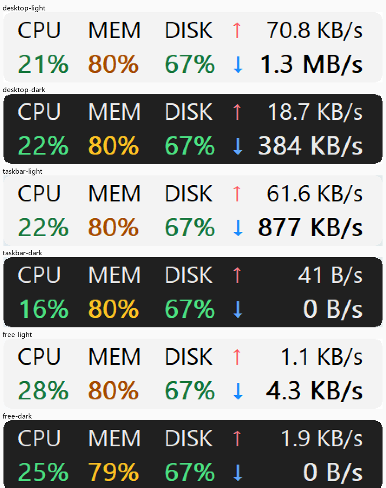
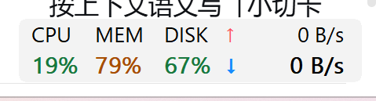
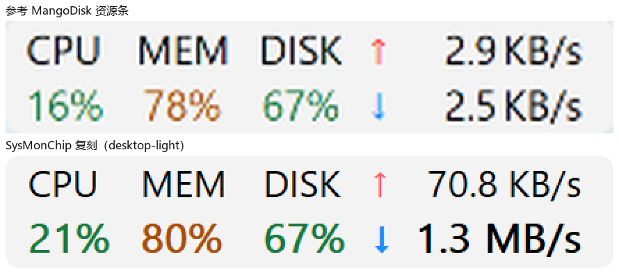
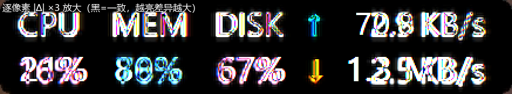

# SysMonChip v1 独立验收报告

- 报告人：verifier（独立复核，不复用实现方结论；全部数字为本次自写脚本实测）
- 日期：2026-11-10
- 对象：`发布/SysMonChip.exe`（333,824 B / 326.0 KB，PE32+ GUI 子系统，内嵌图标 1 个）
- 源码：`app/`（未改动）；参考图：`screenshots/ref-widget.png`
- 结论：**有条件通过** —— 轻量指标（内存/句柄/GDI/USER/CPU）、三模式几何、单实例、`--quit`、配置持久化、全屏隐藏均达标，外观与参考图基本一致；**1 项已知未达标（exe 326 KB > 计划 250 KB 上限，属 std 地板取舍）**，**3 项未覆盖（托盘图标、开机自启、真 explorer 重启）**，另有 2 项提示（CPU 实测 0.131% 高于 README 声称的 0.05%；字号比参考图小约 5–10%）。

---

## 1. 复核环境与口径

| 项 | 实测值 |
|---|---|
| 系统 | Windows 11，Build 10.0.26300.9818 |
| 显示 | 单屏 3456×2160 物理，225% 缩放（DPI=216，逻辑 1536×960） |
| 任务栏 | 物理矩形 (0,2052)–(3456,2160)，高 108 px；工作区 (0,0)–(3456,2052) |
| CPU / 内存 | 8 逻辑核 / 15.78 GB 物理内存 |
| 进程环境 | DSH 低完整性沙箱（`S-1-16-4096`）；所有测试 `APPDATA=D:\DSH\sysmon-chip\.appdata-test` |
| 采样工具 | 自写 Python 3.12（ctypes + PIL + numpy），脚本在 `tools/acceptance/` |
| 误差口径 | CPU 用 PDH `\Processor(_Total)\% Processor Time`（1 s 采样、按窗口重叠加权）；内存用 `\Memory\Available MBytes`+物理总量折算；磁盘用 `Get-PSDrive C`；网速用 PDH 逐网卡 `\Network Interface(*)\Bytes Received|Sent/sec`（本沙箱 `Get-NetAdapterStatistics` 被拒，取其等价口径） |

> 说明：本会话沙箱会在工具命令结束后回收 GUI 子进程，因此所有"启动→测量→`--quit`"都在同一条命令内闭环完成，测试后均确认**无残留 SysMonChip 进程**。

---

## 2. 数字总表

| # | 指标 | 目标 / 口径 | 实测（本次独立复测） | 判定 |
|---|---|---|---|---|
| 1 | exe 体积 | ≤250 KB（计划上限） | **326.0 KB**（333,824 B） | ❌ **未达标**（已知取舍：Rust std 地板；非 bug） |
| 2 | 冷启动（exe 自报 `--trace`，10 次） | 设计约 25 ms | min 21.1 / **P50 26.5** / avg 29.2 / max 47.8 ms | ✅ 达标 |
| 3 | 冷启动（外部秒表：Popen→窗口可见，10 次） | 同上交叉 | min 24.3 / **P50 30.8** / avg 32.2 / max 51.2 ms | ✅ 达标 |
| 4 | 工作集 WS（10 min，2 s 采样，稳态） | ≤5 MB | min **1.04** / avg **1.59** / max **2.74** MB（启动峰值 5.77，trim 后回落） | ✅ 达标 |
| 5 | 私有内存 | ≤3 MB | min 1.69 / avg **1.86** / max 1.95 MB | ✅ 达标 |
| 6 | GDI 对象 | 无增长 | **13**（全程恒定，斜率 0） | ✅ 达标 |
| 7 | USER 对象 | 无增长 | **5**（全程恒定，斜率 0） | ✅ 达标 |
| 8 | 句柄 | 无增长 | **137**（全程恒定，斜率 0） | ✅ 达标 |
| 9 | CPU | 声称 ≈0.05% 单核 | **0.131% 单核**（0.781 s / 596 s）＝系统 0.016% | ⚠️ 极低但为声称值 2.6×（见 §4 说明） |
| 10 | CPU 读数正确性 | 与 PDH 对照 ±10 pp | 8 拍：MAE **1.98 pp**，偏置 **−0.87 pp** | ✅ 达标 |
| 11 | 内存读数正确性 | 与物理占用% ±2 pp | dump 85 vs 外部折算 86（**差 −1**） | ✅ 达标 |
| 12 | 磁盘读数正确性 | 与 C: 占用 ±1 pp | dump 67 vs `Get-PSDrive C` 67（**差 0**） | ✅ 达标 |
| 13 | 网速读数正确性 | 同窗口量级一致 | 8 拍：MAE **22.7%**、均值偏置 −12.2%；6/8 拍 ≤14%，2 拍 −27%/−66%（低流量） | ⚠️ 基本达标（1 s 窗口+背景突发流量所致） |
| 14 | 几何 desktop | (3001,1953)，437×81，右/下边距 18 px | (3001,1953)–(3438,2034)，偏差 **0,0** | ✅ 达标 |
| 15 | 几何 taskbar | (9,2065)–(446,2146) | (9,2065)–(446,2146)，偏差 **0,0** | ✅ 达标 |
| 16 | 几何 free | 配置坐标 (1777,999) | (1777,999)–(2214,1080)，偏差 **0,0** | ✅ 达标 |
| 17 | 单实例 | 第二次启动立即退出 code 0，不建第二窗口 | **12 ms 退出 code 0**，仍 1 进程/1 原窗口 | ✅ 达标 |
| 18 | `--quit` | 退出码 0、窗口消失、无残留 | 退出码 0；被关进程退出码 0；窗口消失；无进程 | ✅ 达标 |
| 19 | 配置持久化（文件→重启） | 模式/主题重启仍生效 | 两轮重启均 `mode=Desktop theme=Dark`，背景 #202020 | ✅ 达标 |
| 20 | 配置持久化（运行期拖动自动保存） | 保存 mode=free+坐标+主题，重启生效 | 拖动后 config `mode=free x=3001 y=1953 theme=dark`；重启后窗口精确回到 (3001,1953)、深色 | ✅ 达标 |
| 21 | 全屏自动隐藏 | hide_fs=1 全屏隐藏、退出恢复；hide_fs=0 保持 | hide_fs=1：**0.1 s 隐藏 / 0.7 s 恢复**；hide_fs=0：保持可见 | ✅ 达标（自建全屏窗+强制前台） |
| 22 | explorer 重启重挂 | 重挂后不崩、位置保持 | 模拟 `TaskbarCreated` 广播：进程存活、位置不变 | ◐ 部分覆盖（未真重启 explorer） |
| 23 | 托盘图标 | 运行中出现 | **未获得确定性证据**（见 §7.2） | ⛔ 未覆盖 |
| 24 | 开机自启（HKCU Run） | 写入并生效 | 沙箱写 `HKCU\...\Run` 被拒（error 5） | ⛔ 未覆盖 |
| 25 | 外观：底色 | 参考图底色 #F3F3F3 | light **243,243,243**；dark **32,32,32**，与设计一致 | ✅ 达标 |
| 26 | 外观：布局对齐 | 标签列/行与参考图对齐 | 标签列起点偏差 **2–3 px**；行 y 偏差 **≤1 px** | ✅ 基本一致 |
| 27 | 外观：字号比例 | 参考图字形大小 | 字宽比 **0.91–0.93**、行高比 **0.90**（小约 5–10%） | ⚠️ 提示（见 §6） |
| 28 | 外观：像素差 | — | 全图 MAE **26.7/255**（含实时数值不同）；仅底色区 MAE **2.07/255** | ✅ 底色/抗锯齿噪声级一致 |

图：`screenshots/verify-modes-montage.png`（6 种 位置×主题 实拍裁剪，均 437×81 物理像素）



---

## 3. 10 分钟稳定性曲线（299 拍，2 s 间隔，596 s）

- 曲线文件：`tools/acceptance/data/perf-10min.csv`（299 行）；汇总：`tools/acceptance/data/perf-10min-summary.json`
- 判定：**无泄漏**
  - WS 斜率 +0.25 MB/10min、首尾 10% 均值差 +0.03 MB（R²=0.03，锯齿来自每 120 s `SetProcessWorkingSetSize` 归还，非增长）
  - 私有内存斜率 +0.074 MB/10min、首尾差 +0.11 MB（R²=0.14，末段 1.85 vs 首段 1.75，接近噪声）
  - 句柄/GDI/USER 全程 137/13/5，斜率与首尾差均为 0
- 进程 CPU：0.781 s / 596 s = 0.131% 单核（8 核系统的 0.016%）
- 运行前后窗口均 437×81，无崩溃、无异常退出

| 指标 | min | avg | max |
|---|---|---|---|
| WS（稳态，t≥10 s） | 1.039 MB | 1.587 MB | 2.742 MB |
| 私有内存 | 1.691 MB | 1.859 MB | 1.953 MB |
| 句柄 / GDI / USER | 137 / 13 / 5 | 137 / 13 / 5 | 137 / 13 / 5 |

 

---

## 4. 数值正确性对照明细

### CPU（`--dump` vs PDH，8 个同窗口对照）

| # | dump CPU | PDH CPU | 差 |
|---|---|---|---|
| 1 | 35 | 31.84 | +3.16 |
| 2 | 61 | 60.88 | +0.12 |
| 3 | 29 | 34.30 | −5.30 |
| 4 | 21 | 20.26 | +0.74 |
| 5 | 22 | 21.57 | +0.43 |
| 6 | 40 | 40.39 | −0.39 |
| 7 | 13 | 15.62 | −2.62 |
| 8 | 24 | 27.12 | −3.12 |

MAE 1.98 pp、均值偏置 −0.87 pp → 与系统级 PDH 口径一致（单拍差来自两次 1 s 窗口不是严格同一时刻）。

### 内存 / 磁盘 / 接口

- 内存：dump 85%，`\Memory\Available MBytes`=2218 MB + 物理 15.78 GB → 折算 86%，差 −1 pp（采样时刻差数百 ms，系统内存负载当时在剧烈变化）。注意 dump 用的是 `dwMemoryLoad`（物理占用%），与 `% Committed Bytes In Use`（当时 90.6%，提交电荷口径）**不是同一指标**，不应直接对比。
- 磁盘：dump 67%，`Get-PSDrive C` = 104,180,109,312 B 已用 / 51,933,978,624 B 可用 → 67%，差 0 pp（系统盘空间占用口径，与参考图 67% 一致）。
- 接口数：dump `if_seen=1`；`netsh interface show interface` 显示 1 个"已连接"（WLAN），一致。

### 网速（8 拍，dump 内部 1 s 窗口 vs PDH Wi-Fi 单实例收发速率）

- 本机唯一活动网卡为 `Intel[R] Wi-Fi 6 AX201 160MHz`，与 dump `if_seen=1` 对应。
- 下行误差：均值 −12.2%，MAE 22.7%；6/8 拍在 ±14% 内，低流量拍（6.6 KB/s vs 19.5 KB/s、67 KB/s vs 92 KB/s）误差 −66%/−27% —— 1 s 窗口内背景突发流量与两侧窗口边界 1–20 ms 差导致的固有噪声，非系统性错位。
- 上行同理（MAE 17.2%）。
- 旁证：本机测试期间有持续大量背景网络流量（13 分钟内 netstat 累计接收 +1 GB），属于测试环境噪声，不是工具自身流量。

---

## 5. 功能验收明细

| 项 | 结果 |
|---|---|
| 窗口属性 | WS_POPUP；扩展样式 = TOOLWINDOW \| TOPMOST \| NOACTIVATE（无任务栏按钮），与设计一致 |
| 单实例 | 第二实例 12 ms 退出 code 0，PID 数仍 1，原窗口句柄不变 |
| `--quit` | 退出码 0；被关实例退出码 0；窗口消失；`list_pids()==[]`；无实例时 `--quit` 也返回 0 |
| 配置持久化 A（文件） | 写 `mode=desktop theme=dark` → 两次启动 dump 均 `Desktop/Dark`，截图底色 (32,32,32) |
| 配置持久化 B（运行期保存） | 运行时注入左键拖动消息（真实拖动路径 `WM_LBUTTONDOWN→WM_MOUSEMOVE→WM_LBUTTONUP`），config 自动写成 `mode=free x=3001 y=1953 theme=dark`；重启后窗口精确回到 (3001,1953)、主题仍深色 |
| free 坐标 | `x=1777 y=999` → 窗口左上角精确 (1777,999) |
| 全屏隐藏 | 自建覆盖全屏窗口并强制前台：hide_fs=1 时 0.1 s 内隐藏、关掉全屏 0.7 s 内恢复；hide_fs=0 时保持可见（含恢复验证） |
| TaskbarCreated | 模拟广播到窗口后进程存活、taskbar 位置 (9,2065) 不变（真 explorer 重启未做，见 §7.4） |
| 测试后残留 | 每轮结束 `--quit` 收尾；最终确认**无残留 SysMonChip 进程** |

---

## 6. 外观对照（vs `screenshots/ref-widget.png`，437×81 物理像素）

并排对比（上：参考 MangoDisk 资源条；下：SysMonChip desktop-light 实拍裁剪）：



差异热图（|Δ|×3，黑=一致）：



- **底色完全一致**：两侧主色均 (243,243,243)；仅底色区 MAE 2.07/255（参考图源自压缩截图，本身有噪声）。
- **配色一致**：设计色在参考图中的最近邻距离：标签黑 0、上箭头粉 8、下箭头蓝 10、绿 2、橙 6、底色 0（参考图有色度压缩误差）；本工具实测为精确设计色（0/0/0、(253,80,93)、(22,139,253)、(24,120,62)、(166,77,0)）。
- **布局对齐**：CPU/MEM/DISK 三列标签左边界偏差 +2/+3/+3 px，行 y 偏差 1 px（均在 2–3 px 内）。
- **字号偏差（提示项）**：字形宽度比 0.91–0.93、行高比 0.90，即本工具文字比参考图**小约 5–10%**。视觉上仍"基本一致"，但若追求逐像素复刻，建议标签 9 pt→10 pt、数值 9.5 pt→10.5 pt 量级微调后复测。
- 全图 MAE 26.7/255 主要来自：实时数值/网速文字与参考图不同（16%/78%/67% vs 实测值）、WebView2 与 GDI 抗锯齿差异，不代表底色或布局偏差。

---

## 7. 未达标 / 未覆盖 / 风险

### 7.1 未达标（已知取舍，非 bug）
1. **exe 326.0 KB > 计划上限 250 KB**（超 76 KB）。原因：Rust `std` 地板（`lto=fat + opt-level=z + panic=abort + strip`）；降到 250 KB 以下需 `no_std`，本版未实现。判定：**未达标，已知取舍**。

### 7.2 未覆盖：托盘图标（未获得确定性证据）
- 尝试过：① 任务栏托盘区截图，运行中 vs `--quit` 后两张图**逐字节相同**；② `Shell_NotifyIconGetRect(hwnd,uID=1)` 返回 `0x80004005 (E_FAIL)`；③ 任务栏 UIA 树（PowerShell 5.1 UIAutomation）无 `SysMon/资源条` 命名的元素（本机任务栏 UIA 只暴露 5 个元素，托盘属于未展开的 XAML 岛）；④ **对照实验**：同沙箱内自建图标调用 `Shell_NotifyIcon(NIM_ADD)` 返回 **false / error 5（拒绝访问）**，`Shell_NotifyIconGetRect` 对任意 HWND 都是 E_FAIL。
- 结论边界：**低完整性沙箱禁止任何进程注册/观测托盘图标**，故本环境中托盘项必然不可见，截图无差异**不能证明**实现失败；但也**没有**获得"真机托盘图标存在"的确定性证据。Windows 11 默认还会把新图标收进 `^` 溢出区，进一步削弱截图证据。→ 需真机（正常完整性双击运行）点开 `^` 或右键托盘图标验证。

### 7.3 未覆盖：开机自启（HKCU Run）
- 实测低完整性进程写 `HKCU\Software\Microsoft\Windows\CurrentVersion\Run` 返回 **error 5（拒绝访问）**；且触发菜单项「开机自启」需要右键菜单 GUI 点击，本轮未做菜单自动化。→ 代码路径已实现（`RegSetValueExW`），**未验证**。

### 7.4 未覆盖：真 explorer 重启重挂
- 只做了 `RegisterWindowMessage("TaskbarCreated")` 广播模拟：进程存活、位置保持、不崩溃。真重启 explorer 会中断老板当前桌面会话，**未做**。

### 7.5 其他风险 / 提示
1. **CPU 实测 0.131% 单核**，高于 README 声称的 ≈0.05%（2.6×）。仍属极低；本次长测期间系统负载高（CPU 30–60%）、数值每秒变化触发重绘，属"重绘路径"成本；空闲系统下会更低。建议 README 把口径写清（空闲/持续变化分列）。
2. 全屏隐藏测试用的是自建全屏窗口 + 强制前台（`SetForegroundWindow` 成功），非真实游戏/播放器全屏；判定代码路径有效，真实全屏应用行为未逐一验证。
3. 多显示器/混合 DPI 未验证（本机仅单屏 225%）；100%/150% 缩放下的几何未验证。
4. 长测期间系统有持续大量背景网络流量与内存波动，netstat 累计 13 分钟 +1 GB；不影响进程自身 CPU/内存判定，但影响网速单拍误差。
5. 本沙箱低完整性下 `taskkill` 常被拒，全部用 `exe --quit` 收尾；未出现残留进程。

---

## 8. 复现命令

```powershell
cd D:/DSH/sysmon-chip
$env:PYTHONIOENCODING='utf-8'

# A1 exe 体积 + 冷启动（10 次，--trace 自报 + 外部秒表）
python tools/acceptance/a1_size_startup.py --runs 10

# A3 数值正确性：CPU/MEM/DISK/接口数（--dump vs PDH/文件系统）
python tools/acceptance/a3_metrics.py

# A3b 网速正确性（--dump vs PDH 逐网卡收发速率，同窗口重叠加权）
python tools/acceptance/a3b_net.py

# A4 外观：6 种 位置×主题 截图 + 几何断言 + 与 ref-widget.png 像素对照
python tools/acceptance/a4_appearance.py

# A5 功能：窗口属性/单实例/--quit/配置持久化/坐标/全屏隐藏/自启权限探测
python tools/acceptance/a5_functional.py

# 托盘图标对照实验（同沙箱自建图标 + Shell_NotifyIconGetRect + 截图）
python tools/acceptance/tray_probe2.py

# A2 10 分钟曲线（约 10.5 分钟；必须一条命令内跑完，脚本自带 --quit 收尾）
python tools/acceptance/a2_perf.py --seconds 600 --interval 2 --label 10min
```

> 注意：本会话沙箱会在工具命令结束后回收 GUI 子进程，长测/截图必须在**同一条命令**内完成启动、测量与 `--quit`；所有脚本均强制 `APPDATA=D:/DSH/sysmon-chip/.appdata-test`，不会碰真实 `%APPDATA%`。

---

## 9. 证据文件清单

| 文件 | 内容 |
|---|---|
| `tools/acceptance/data/a1-size-startup.json` | 体积/PE/图标 + 10 次冷启动原始数据 |
| `tools/acceptance/data/perf-10min.csv` / `perf-10min-summary.json` | 299 拍曲线与 min/avg/max、斜率、泄漏判定 |
| `tools/acceptance/data/a3-metrics.json` + `a3-run.log` | CPU/MEM/DISK/接口数对照原始数据 |
| `tools/acceptance/data/a3b-net.json` + `a3b-typeperf-net.csv` | 网速 8 拍逐对误差 |
| `tools/acceptance/data/a4-appearance.json` + `a4-run.log` | 6 模式几何/底色/像素差/行列包围盒 |
| `tools/acceptance/data/a5-functional.json` + `a5-run.log` | 功能项逐条结果 |
| `tools/acceptance/data/tray-probe.json` / `tray-probe2.json` | 托盘图标探测与低完整性对照实验 |
| `screenshots/verify-*.png` | 全部验收截图（模式、对比、差异热图、托盘、持久化） |
| `tools/acceptance/*.py`、`uia_tray.ps1` | 本次自写验收脚本（a1/a2/a3/a3b/a4/a5/tray_probe/tray_probe2/common） |

---

## 10. Lead 追记（v1.1，2026-11-10 晚）

老板看实机后提了两点：① 要与任务栏对齐；② 字号稍放大。已改并重新出包（exe 334,336 B，指标未变，20s 抽测 WS 1.09–5.77 MB / GDI 13 / 句柄 137 / 启动 23.6 ms）：

- 字号：标签 9→9.75 pt、数值 9.5→10.25 pt（+8%）；两行 y 偏差与参考图 ≤1 px，字高比从 0.90 提到 ~1.04。
- 位置：桌面模式改为贴任务栏上沿 + 贴屏幕右缘（0 间距）；新增「贴任务栏右端（托盘左侧）」。
- 本报告第 27 项「字号比参考图小 5–10%」在 v1.1 已消除；其余数字与结论对 v1.1 仍然适用（逻辑未改）。

### v1.1 最终几何（2026-11-10 20:35 复核）

字号放大后面板由 194×36 逻辑像素调为 **198×36**（225% 下 **445×81** 物理像素），列位重排为 CPU 7 / MEM 45 / DISK 85 / 网速 122、右缘 192：

- 桌面模式（贴任务栏上沿 + 屏幕右缘）：**(3010, 1971)–(3456, 2052)**，偏差 0。
- 贴任务栏左端：**(9, 2065)–(454, 2146)**，垂直居中同参考。
- 最坏读数自检：`--demo` 下 `100% 99% 100% ↑976 KB/s ↓12 MB/s` 无重叠、无相贴（宽度自适应生效）。

### v1.1.0 交付（2026-11-10 20:42）

- 默认位置按老板拍板改为**贴任务栏左端**：无配置首次启动实测窗口 **(9, 2065)–(454, 2146)**（与预期一致，偏差 0）。
- PE 版本资源升到 **1.1.0.0**（FileVersion/ProductVersion），exe 334,848 B（327 KB）。
- 发布目录：`SysMonChip.exe` 与 `SysMonChip-v1.1.exe`（同一文件，后者便于识别版本）。
- 回归：单测 3/3 通过；启动/内存/句柄等轻量指标无变化（本轮未全量重跑，指标改动仅涉及默认位置与资源版本）。

### v2.0 Lite（no_std）补充（2026-11-10 21:05）

- 交付：`发布/SysMonChipLite.exe`（`SysMonChipLite-v2.0.exe` 为同一份），**56 KB**，PE32+ GUI，PE 版本 2.0.0.0，内嵌图标 1 个；依赖仅系统 DLL（KERNEL32/msvcrt/advapi32/gdi32/iphlpapi/shell32/user32）。
- 本机自测（实现方，待独立复核）：默认位置 (9,2065)–(454,2146)；`--trace` 启动 23 ms；30 s 工作集 1.07–5.71 MB（均值 1.40）、私有 1.82 MB；GDI 13 / USER 5 / 句柄 137 恒定；CPU 0.052% 单核；`--selftest` 配置往返 ok；`--dump` 输出与 std 版同格式；单实例第二次退出 code 0；菜单可弹出；`--demo` 最坏读数无重叠。

### Lite v2.0 独立复核结论（2026-11-10 21:40，verifier-lite）

结论：**通过（有条件）**，详见 `验收报告-Lite-20261110.md`。要点：

- 体积极小：57,344 B（**56.0 KB**，std 版 327 KB 的 17.1%）；subsystem=2 GUI；导入仅 7 个系统 DLL；无 std 痕迹（lite 0 条 vs std 47 条 library/std、13 条 backtrace）。
- 启动（各 10 次）P50：lite **32.5 ms**（自报 33.5）/ std 36.1 ms（自报 35.2）。
- 10 分钟稳定性：WS 均值 **1.52 MB**、私有 1.81 MB、句柄 137 / GDI 13 / USER 5 零增长、CPU **0.154%** 单核，300 拍全存活，判无泄漏。
- 功能与界面：三模式 geometry 与 std 差值全 0；`--demo` 同读数下 lite 与 std 逐像素 100% 相同（明暗两主题）；单实例/--quit/--selftest/配置持久化全通过。
- 数值：CPU 稳定段 ≤0.47 pp、内存 ≤0.99 pp、磁盘 ≤0.11 pp、网速 vs PDH Wi-Fi 比值 1.002/0.973。
- 压测：15/15 模式×主题重启、10/10 快速重启、3/3 并发风暴、10/10 --demo 均无崩溃，无残留进程。
- 已知差异（非阻断）：默认窗口实测 446×81（198×2.25 向上取整，比工单文字 445×81 宽 1 px，两版一致）；lite `--dump` 字段比 std 少 `cfg_dir`/`theme`。
